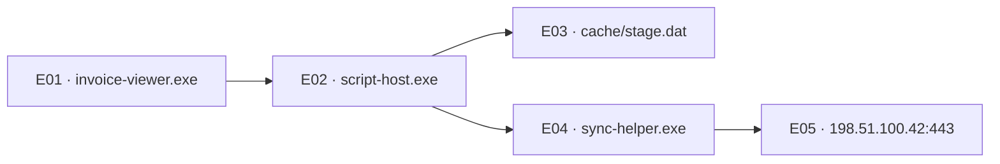

# Case 07 · Document viewer investigation

**Question.** Did the process that opened the invoice start a descendant that connected to an external address?

**Finding.** Yes. On workstation-07 the viewer launched a script host, which launched a helper. The helper connected to 198.51.100.42:443 fourteen seconds after the viewer started. The capture contains no payload, destination ownership or executable hash. Treat malicious execution as a hypothesis.

| Evidence | UTC time | What it establishes |
| --- | --- | --- |
| E01 → E02 | 09:10:00–05 | The script start names the viewer's process instance as parent. |
| E03 | 09:10:07 | The script generated a file event for the staging path. The operation and contents are unknown. |
| E04 → E05 | 09:10:10–14 | A child of the script initiated the recorded connection. |

## Competing explanations

The browser also connected externally at 09:10:15 (E07), but its process start (E06) has no link to the viewer. Workstation-08 reused the helper identifier (E08–E09); host scoping excludes it. E10 predates the script start. Clock drift or identifier reuse could explain it, so it is omitted from this attribution.

## Next collection

Request process command lines and image hashes for E02 and E04, then compare them with the software inventory. Collect the file referenced by E03 and the proxy or firewall session matching E05. Those artifacts can distinguish a legitimate update from a staged payload.
